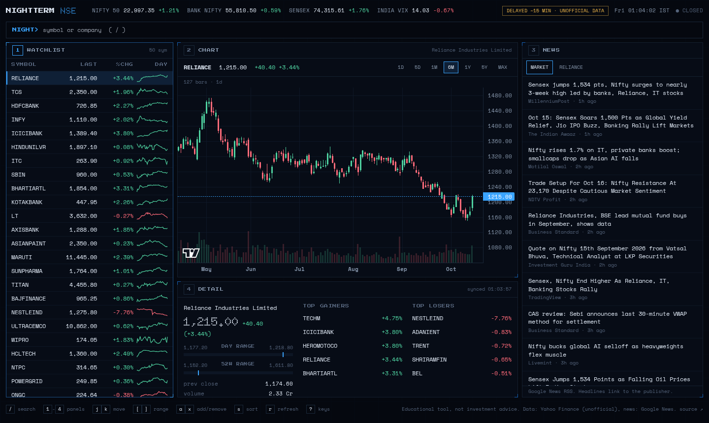
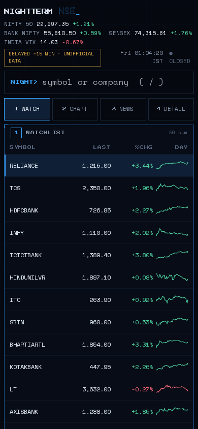
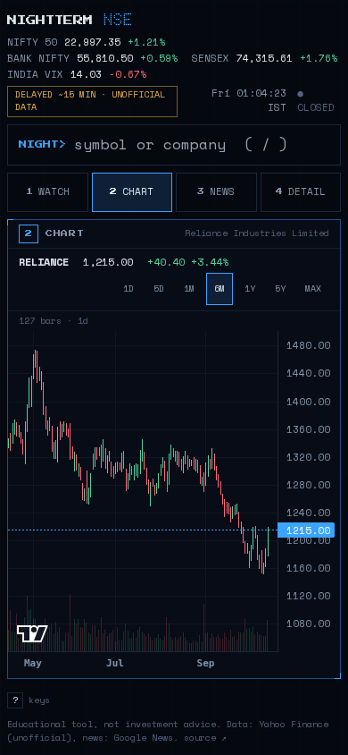
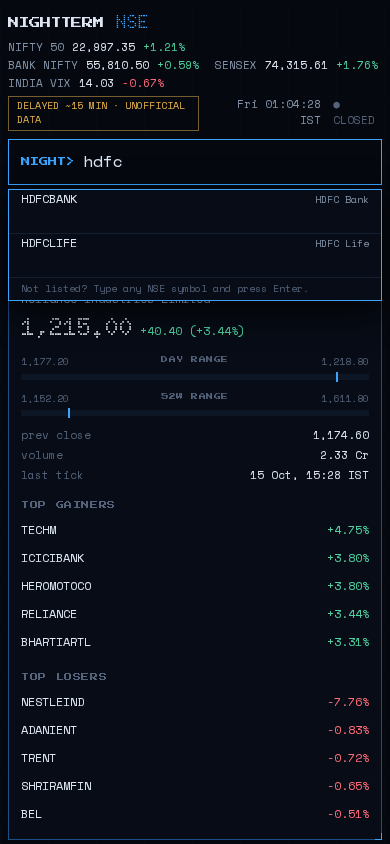

# NIGHTTERM

A keyboard-driven mini terminal for the Indian market. NIFTY 50 watchlist with sparklines, candlestick charts, a market news feed, and a command line you drive without touching the mouse.

**Live:** https://mjanthony819.github.io/nightterm/  (API on Render's free tier, first load can take up to a minute)



| Mobile: watchlist | chart | search |
|---|---|---|
|  |  |  |

## Panels and keys

| Key | Does |
|---|---|
| `/` | jump to the command line, type a symbol or company, Enter |
| `1` `2` `3` `4` | focus watchlist, chart, news, detail (tabs on phones) |
| `j` `k` or arrows | move through the watchlist, or the headlines when news is focused |
| `[` `]` or `,` `.` | previous / next range: 1D 5D 1M 6M 1Y 5Y MAX |
| `a` `x` | add / remove the selected symbol from your watchlist |
| `s` | cycle sort: list order, % change down, % change up, A-Z |
| `r` | refresh |
| `?` | help |

Commands: `TCS` loads a symbol (any NSE ticker works, e.g. `IRCTC`, `m&m`), `add SYM`, `rm SYM`, `reset`.
Your watchlist is saved in the browser's localStorage only.

## Honest labeling

- Quotes are **delayed about 15 minutes** and come from Yahoo Finance's unofficial chart endpoint. This is not exchange data and can be wrong or unavailable.
- The open/closed light is Mon-Fri 09:15-15:30 IST and ignores exchange holidays.
- The NIFTY 50 list is a snapshot in `backend/terminal/universe.py`. Index membership changes at rebalances, so it can lag.
- News headlines come from Google News RSS and link to the publishers. Not investment advice.

## Architecture

```
backend/   FastAPI. terminal/{yahoo,news,cache,universe}.py, main.py, tests/
frontend/  Next.js static export, Tailwind, lightweight-charts. No native select/datalist.
render.yaml, Dockerfile            API on Render (Blueprint)
.github/workflows/                 ci, deploy-frontend (GitHub Pages), keepalive (optional)
```

| Endpoint | |
|---|---|
| `GET /quotes?symbols=A,B,...` | price, change, day/52w stats and a sparkline per symbol. Cached 45 s, max 60 symbols |
| `GET /history?symbol=&range=1D\|5D\|1M\|6M\|1Y\|5Y\|MAX` | OHLCV bars. Cached 2 min (intraday) or 30 min (daily) |
| `GET /news?symbol=` | parsed Google News RSS, market-wide or per stock. Cached 5 min |
| `GET /universe`, `GET /search?q=`, `GET /health` | NIFTY list, local search, health check |

The cache is shared by all visitors, so a hundred people on the page cost the same upstream calls as one. If Yahoo fails, the last good answer is served (marked stale) for up to an hour.

## Run it

```
cd backend && pip install -r requirements-dev.txt && python -m pytest -q && uvicorn main:app --port 8000
cd frontend && npm install && npm run dev      # http://localhost:3000
```

Deploy: see [docs/DEPLOY.md](docs/DEPLOY.md).

MIT licensed.
